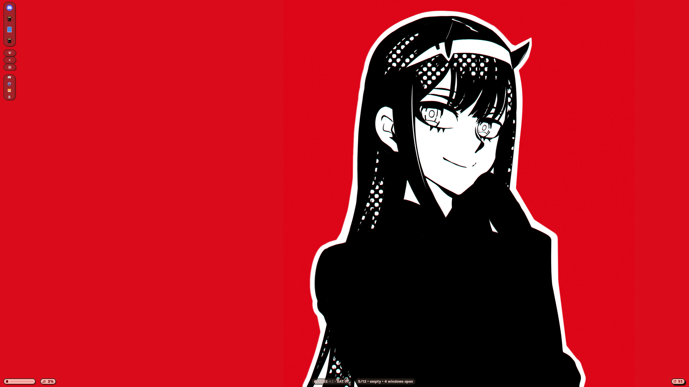
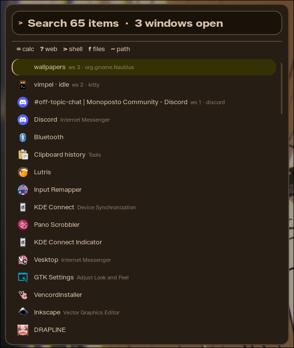
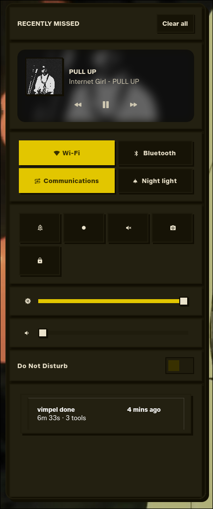
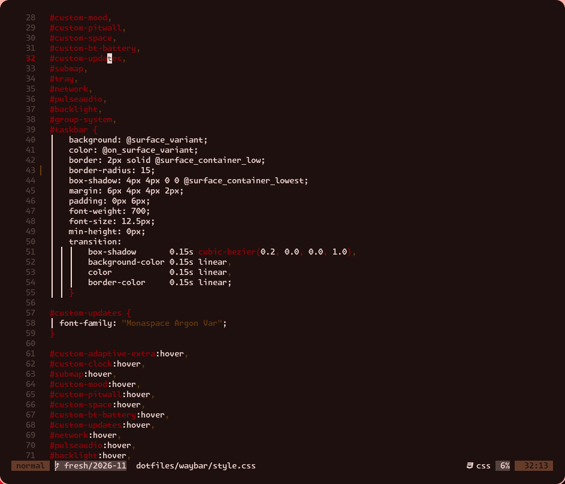

# dotfiles

cachy + hyprland, themed with matugen



## screenshots

| | |
|---|---|
|  |  |
|  | |

## what's inside

| area | stack |
|---|---|
| compositor | hyprland 0.55, hyprbars + dynamic-cursors plugins |
| bar | waybar, two layouts |
| launcher | rofi (omniapps / omniscreenshot) |
| notifications / OSD | swaync + swayosd |
| lock | hyprlock |
| wallpaper | awww |
| theming | **matugen**, one wallpaper generates every color |
| editor | lazyvim with matugen colorscheme |
| terminal | kitty (matugen theme) |
| shell | zsh |
| system | btop, cava, vkbasalt, gtk3/4 + qt5ct/6ct |

## pipeline

two inputs drive everything:

- `appearance.json` — fonts, corner radius, border widths, spacing, motion
- a wallpaper → `matugen image <wallpaper>`

Then:

```sh
matugen image ~/wallpapers/foo.png   # regenerates all colors
node build.js                          # merges colors + appearance.json into every config
```

matugen templates write to waybar/swaync/swayosd/rofi/kitty/gtk/hypr/nvim
(`matugen/templates/`), `build.js` appends edits the tokens (fonts, radius,
spacing) on top. change the wallpaper or edit `appearance.json` → one command →
whole desktop re-themes

## installing

```sh
git clone <this repo> ~/dotfiles
cd ~/dotfiles
./install.sh          # installs 215 packages (pacman + AUR), symlinks configs
```

`install.sh` backs up any existing `~/.config/<pkg>` to `.bak` before
linking, and is safe to re-run

## keybinds (super is caps lock)

| Key | Action |
|---|---|
| `SUPER + Q` | close window |
| `SUPER + F` | toggle float |
| `SUPER + C` | center floating window |
| `SUPER + F11` | fullscreen |
| `SUPER + TAB` | cycle windows |
| `SUPER + G` | toggle group |
| `SUPER + SHIFT + WASD` | move focus |
| `SUPER + 1-9` | switch workspace |
| `SUPER + SHIFT + 1-9` | move window to workspace |

the full list is in `hypr/keybindings.lua`

## layout

```
├── hypr/          # hyprland.lua + keybindings/windowrules/animations/monitors/colors
├── waybar/        # config.jsonc + style.css + scripts/ (adaptive.py, updates.py, …)
├── rofi/          # launcher + omni* scripts
├── swaync/        # notifications + control center
├── nvim/          # LazyVim + matugen integration
├── kitty/ gtk-*/ qt5ct/ qt6ct/ matugen/ …
├── appearance.json  # fonts / radius / spacing / motion tokens
├── build.js         # appearance + matugen → all configs
├── install.sh       # package install + stow-style symlinking
├── screenshots/     # readme gallery
└── wallpapers/
```
